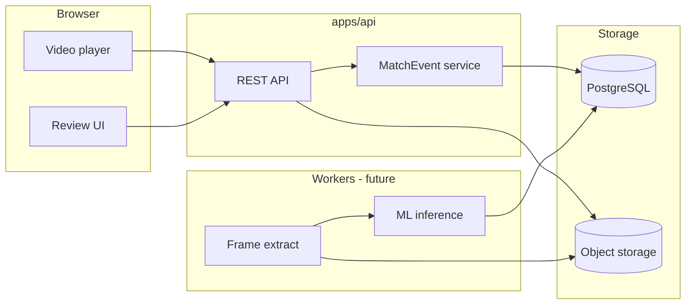

# Phase 7 — Video & ML Discovery

**Дата:** 2026-10-15  
**Статус:** исследование; реализация не начата.  
**Связанные документы:** [step1-real-data-source-contract-discovery.md](./step1-real-data-source-contract-discovery.md), [0002-data-origin-and-provenance.md](../decisions/0002-data-origin-and-provenance.md), [0003-ingestion-runs-journal.md](../decisions/0003-ingestion-runs-journal.md), [data-model.md](../data-model.md), [analytics-definitions.md](../analytics-definitions.md).

**Главная цель продукта (целевая):** веб-приложение для волейбольной **видеоаналитики** — просмотр записи/трансляции матча, автоматическое обнаружение событий (CV/ML), структурированные данные, статистика команд и игроков, **ручная проверка и исправление** автоматических событий.

**Текущий репозиторий** реализует read-only **табличную** аналитику по счёту сетов (Phase 4–6), без видео и без `MatchEvent`.

---

## 1. Текущее состояние проекта

### 1.1. Доменная модель (есть в PostgreSQL)

| Сущность | Назначение | Связь с видео/ML |
|----------|------------|------------------|
| `leagues`, `seasons` | Контекст соревнования | Сезон — scope для матчей и будущих разметок |
| `teams`, `players`, `team_rosters` | Справочники, состав на сезон | Игрок для события — только если **достоверно** известен (номер, калибровка) |
| `matches` | Стороны, статус, `scheduled_at`, `venue` | Точка привязки **одного** видео на матч (модели нет) |
| `set_results` | Итоговый счёт сета | Не заменяет порам/розыгрыши; согласование с видео — отдельная задача |

**Нет в схеме:** `MatchEvent`, видеофайл/URL, таймкоды, треки, детекции, job обработки, confidence, статус ревью.

Статусы матча: `scheduled` | `completed` | `cancelled`. Корректность итога — `evaluate_match_result` ([match-result-validity.md](../match-result-validity.md)); правило «+2 в сете» не проверяется.

### 1.2. API и frontend (есть)

- API v1: **только GET** ([api.md](../api.md)) — сезоны, команды, игроки, матчи, dashboard, team analytics.
- Аналитика команды: матчи, сеты, очки, `match_timeline` — из `set_results` ([analytics-definitions.md](../analytics-definitions.md)).
- Аналитика игрока: **rosters** + `note` о недоступности статистики без `MatchEvent` (`api_responses.py`).
- Frontend: списки и карточки матчей/команд/игроков, dashboard, Recharts timeline по матчам — **без** плеера, таймлайна событий, форм редактирования.

`data_origin: "demo"` в ответах — константа схемы; не отражает происхождение видео (см. ADR 0002, Proposed).

### 1.3. Ingestion (есть)

- JSON v1 через CLI: лига, сезоны, команды, игроки, составы, матчи, сеты ([file-format-v1.md](../ingestion/file-format-v1.md)).
- Strict writer, `ingestion_external_keys` (`source=file`).
- **Нет** полей событий, таймкодов, ссылок на видео.
- AVL — заглушка; контракт не подтверждён.

### 1.4. Видео, кадры, ML (отсутствует)

| Область | Факт в репозитории |
|---------|-------------------|
| Хранение видео | Нет S3/MinIO/volume для media; Compose только `pgdata` |
| Стриминг / HLS / DASH | Нет |
| Извлечение кадров | Нет ffmpeg/OpenCV в зависимостях API |
| ML/CV | Нет PyTorch/ONNX/Ultralytics и т.п. |
| Фоновые задачи | Нет Redis/Celery/RQ/worker-сервиса в `docker-compose.yml` |
| Браузерный CV | Не предполагается как надёжный путь для произвольной трансляции в real-time |

### 1.5. Docker Compose (есть)

Сервисы: `db` (PostgreSQL 16), `api` (FastAPI), `web` (Next.js). Healthcheck у `db` и `api`. **Отдельного worker** для длительной обработки видео нет; добавление потребует нового сервиса(ов) и политики ресурсов (CPU/GPU, очередь).

### 1.6. Существующее vs предполагаемое

| Существует | Предполагается (не реализовано) |
|------------|----------------------------------|
| Матч + сеты + команды + составы | Видеоasset на матч, синхронизация времени |
| Агрегаты по счёту сетов | События розыгрышей, удары, подачи, блоки |
| Read-only UI | Плеер, разметка, ревью ML |
| CLI импорт табличных данных | Pipeline CV/ML + запись `MatchEvent` |
| — | Real-time анализ произвольного стрима в браузере без backend |

### 1.7. Связь с ADR 0002 и 0003 (остаются актуальными)

Направление Video & ML **не отменяет** подготовку к реальным **табличным** данным:

- **[0002](../decisions/0002-data-origin-and-provenance.md) (Proposed):** корректная маркировка источника сезона/лиги в API/UI; без этого смешение demo-матчей, import и будущих «официальных» данных останется непрозрачным и для видео-экранов.
- **[0003](../decisions/0003-ingestion-runs-journal.md) (Proposed):** audit импорта расписания/составов; отдельно от журнала может понадобиться **`processing_run`** для видео (см. §2) — не путать с `ingestion_runs`.

События с `origin=ml` и `confidence` должны быть согласованы с политикой provenance (0002) и не подменять `data_origin` сезона.

---

## 2. Целевая архитектура Video & ML

### 2.1. Pipeline (логические этапы)

```text
Video source (файл / лицензированный URL / позже — ingest с правами)
    → video access & storage (object storage или локальный volume; не в PostgreSQL blob)
    → playback & clock sync (плеер + match clock: wall time ↔ video time)
    → optional: proxy/transcode (HLS для браузера)
    → frame extraction (backend/worker, fps/sample policy)
    → detection (players, ball)
    → tracking (multi-object, court homography — позже)
    → event detection / classification (действия, конец розыгрыша)
    → optional: player identity (jersey OCR, re-id — высокий риск)
    → human review & correction (UI)
    → canonical MatchEvent (+ provenance, confidence, review state)
    → analytics API (агрегаты по событиям + существующие set-level метрики)
    → frontend (плеер, timeline, stats)
```

**Не в браузере:** тяжёлый inference и полный проход по записи; браузер — воспроизведение, UI разметки, вызов API.



### 2.2. Компоненты: прототип vs отложить

| Компонент | Первый работающий прототип | Отложить |
|-----------|----------------------------|----------|
| Привязка видео к матчу (метаданные + URL/path) | Да | DRM, multi-camera |
| HTML5 video / один формат (MP4) | Да | Адаптивный стрим для prod |
| Ручные события + таймкоды | Да | — |
| `MatchEvent` в БД + CRUD API | Да | — |
| Таймлайн UI + простая статистика по размеченным событиям | Да | Продвинутые дашборды |
| Worker + очередь jobs | Желательно до batch ML | Real-time inference |
| Детекция игроков/мяча | Эксперимент offline на клипах | Prod auto-pipeline |
| Трекинг + homography | Нет в MVP | Фаза 2+ |
| Классификация действий | Нет в MVP (или 1–2 класса pilot) | Полный набор FIVB-стат |
| Идентификация игрока по видео | Нет в MVP | Требует разметки и этики |
| Авто-конец розыгрыша | Нет в MVP | Исследование |
| Синхронизация с официальным счётом сета | Ручная/опциональная сверка | Авто без ground truth |

### 2.3. Границы монолита

Сохранить правило: бизнес-логика не в React; SQL не во frontend. ML — **отдельный worker** (или подпроцесс с чётким контрактом), запись только в каноническую модель через API/сервисный слой. Результаты inference — версионируемые «предложения» до ревью (статус `pending_review` / `confirmed` / `rejected`).

---

## 3. Минимальный Video MVP

**Цель:** проверить ценность на **одной** видеозаписи с **подтверждёнными правами** (не скачивать и не использовать чужие трансляции без разрешения).

### 3.1. Сценарий пользователя

1. Открыть карточку матча, у которого задан источник видео (файл, размещённый ops, или разрешённый URL).
2. Смотреть видео в embedded player; перематывать.
3. Перейти к временной метке (из списка событий или ввод `mm:ss`).
4. Создать событие вручную: тип (минимальный enum), `video_offset_ms`, привязка к **сету** (обязательно), команда (обязательно), игрок (опционально, если выбран из состава).
5. Редактировать и удалять свои/операторские события (после появления auth — уточнить).
6. Видеть ленту/таймлайн событий под плеером.
7. Видеть простую статистику по **подтверждённым** событиям (счётчики по типу и команде; не претендовать на официальную FIVB-статистику).

### 3.2. Минимальный контракт данных (предложение для следующей фазы проектирования)

Не миграция в рамках этого документа — только требования:

| Поле / сущность | Назначение |
|-----------------|------------|
| `match_video` (или поля на `matches`) | `storage_key` / URL, duration, mime, checksum, rights_attestation flag |
| `match_events` | `match_id`, `set_number`, `team_id`, `player_id` nullable, `event_type`, `video_offset_ms`, `wall_clock` nullable |
| Provenance | `source`: `manual` \| `ml` \| `import`; `confidence` nullable; `review_status` |
| Связь с ML | `ml_suggestion_id` nullable, ссылка на batch job |

Игрок **не** заполняется автоматически в Video MVP, если нет уверенной привязки (номер на майке + калибровка кадра).

### 3.3. Вне scope Video MVP

- Автоматическая детекция в prod UI.
- Live-трансляция.
- Мульти-камера.
- Публичная загрузка видео пользователями без модерации и прав.
- Замена официального протокола матча.

---

## 4. План ML MVP

Этапы сравниваются по возрастанию сложности. **Конкретная модель и облако не выбираются** без пилотных данных и требований к latency/cost.

### 4.1. Обнаружение игроков

| | |
|--|--|
| **Вход** | Кадры видео (RGB), опционально ROI площадки |
| **Выход** | Bounding boxes + class «person» / «player» |
| **Сложности** | Окклюзии, скамейка, судьи, низкое разрешение любительских записей |
| **Качество** | mAP@IoU на размеченном val; визуальная выборка на 1–2 матча |

### 4.2. Обнаружение и отслеживание мяча

| | |
|--|--|
| **Вход** | Кадры, опционально optical flow |
| **Выход** | Координаты мяча по времени |
| **Сложности** | Мяч маленький, motion blur, частота кадров |
| **Качество** | Distance/error от разметки; % кадров с успешным треком |

### 4.3. Определение игровых действий

| | |
|--|--|
| **Вход** | Клипы (окна 1–3 с), треки, опционально аудио |
| **Выход** | Класс действия (подача, атака, блок, … — урезанный набор) |
| **Сложности** | Мало размеченных данных; класс imbalance |
| **Качество** | Macro-F1 на hold-out матчах; калибровка confidence |

### 4.4. Идентификация конкретных игроков

| | |
|--|--|
| **Вход** | Crop игрока, номер, roster матча |
| **Выход** | `player_id` или «unknown» |
| **Сложности** | Номера не всегда видны; однотипная форма; GDPR/биометрия при re-id |
| **Качество** | Top-1 accuracy при видимом номере; явный порог «не угадывать» |

### 4.5. Результат розыгрыша (очко)

| | |
|--|--|
| **Вход** | Состояние до/после розыгрыша, положение мяча, стороны |
| **Выход** | Очко home/away, конец розыгрыша |
| **Сложности** | Нужна синхронизация с правилами и счётом; ошибка каскадируется в статистику |
| **Качество** | Agreement с ручной разметкой розыгрышей; сверка с `set_results` только как **validation**, не как авто-истина без ревью |

### 4.6. Рекомендуемая последовательность ML-экспериментов (не prod)

1. Offline: детекция игроков на **коротких клипах** (1 разрешённая запись).
2. Offline: мяч (если качество записи достаточное).
3. Ручная разметка **10–20 розыгрышей** → baseline классификатор клипов (2–3 класса).
4. Только после метрик — интеграция «предложений» в UI ревью.
5. Идентификация игроков и авто-очки — **после** стабильного ревью-процесса.

---

## 5. Требования к данным и оценке точности

### 5.1. Объём для первого эксперимента

| Тип | Минимум (ориентир) | Примечание |
|-----|-------------------|------------|
| Полная запись матча | 1 с правами | Не обучающий датасет сама по себе |
| Размеченные кадры (detection) | 500–2000 bbox | Ручная или semi-auto; любительское видео |
| Размеченные розыгрыши (клипы) | 50–200 | Для пилота классификации |
| Матчи в val | ≥1 матч не в train | Split **по матчу**, не по кадрам |

Публичные датасеты волейбола в репозитории **не зафиксированы**; наличие YouTube-роликов **не** считается разрешением на обучение. Каждый источник — отдельное legal review.

### 5.2. События с точными таймкодами

Для обучения/оценки клипов и sync:

- Начало/конец розыгрыша (или момент контакта с мячом для класса действия).
- Привязка к `video_offset_ms` с допустимой погрешностью (например ±200 ms — зафиксировать в гайде разметки).
- Сет (`set_number`) обязателен для событий, влияющих на статистику.

### 5.3. Train / val / test

- Split по **match_id** (и при возможности по турниру/залу).
- Запрет случайного split по кадрам из одного матча (утечка).
- Hold-out для «новой камеры» / нового зала — желательно.

### 5.4. Метрики

| Задача | Метрики |
|--------|---------|
| Detection | mAP, recall на мяч/игрок |
| Tracking | MOTA/MOTP (если есть track ids в разметке) |
| Классификация действий | Precision/Recall/F1 по классу, confusion matrix |
| End-to-end для продукта | % событий, принятых без правки; время ревью на матч |
| Сверка со счётом | Доля расхождений с `set_results` при manual ground truth |

### 5.5. Confidence и происхождение ML-событий

- Каждое авто-событие: `source=ml`, `confidence` ∈ [0,1], `model_version`, `processing_run_id`.
- В аналитике по умолчанию: только `review_status=confirmed` (политика — продукт).
- Ручные правки: `source=manual`, сохранять ссылку на исходное ML-предложение для аудита.
- Согласование с ADR 0002: `data_origin` сезона ≠ происхождение отдельного события.

### 5.6. Ревью пользователем

- UI: принять / отклонить / изменить тип, время, игрока.
- Пакетные операции («принять все выше порога 0.9») — только после исследования ошибок.
- История изменений (кто, когда) — желательно; auth пока отсутствует в проекте.

---

## 6. Риски и технические неизвестные

| Риск | Описание |
|------|----------|
| Права на видео | Блокер для любого ML; без legal нет pipeline |
| Качество любительского видео | Низкий FPS, экспозиция, одна камера — деградация CV |
| Нет GPU в Compose по умолчанию | Inference на CPU медленный; нужна стратегия (cloud batch vs local) |
| Идентификация игроков | Ошибки → неверная персональная статистика; этические ограничения |
| Расхождение event-stats и `set_results` | Два источника правды; нужны правила приоритета |
| Scope creep | Совмещение AVL import, video и ML без фаз |
| Auth / multi-user review | Сейчас нет; разметка в shared DB рискованна |
| Хранение больших файлов | Postgres не для blob; нужен object storage или явный volume |
| Real-time ожидания | Браузер не заменит backend inference |
| Датасеты | Нельзя предполагать доступность размеченных корпусов |

**Технические неизвестные:** формат камеры (1080p/720p), частота кадров, длительность матча, освещение, наличие номеров на майках, язык комментариев (если audio), требования к задержке (batch vs near-live).

---

## 7. Рекомендуемая последовательность этапов

| Этап | Содержание | Зависимости |
|------|------------|-------------|
| **V0** | Продуктовые решения (§8); права на 1 видео | — |
| **V1 — Video MVP** | Модель `MatchEvent` + video metadata; write API; плеер + ручная разметка + простая статистика | V0 |
| **V2 — Ops** | Object storage, worker scaffold, job status (можно переиспользовать идеи 0003 для run journal) | V1 |
| **V3 — ML offline** | Разметка пилота, baseline detection на клипах, метрики | V0 legal, V2 желательно |
| **V4 — ML assist** | Предложения в UI + ревью + confidence | V1, V3 |
| **Параллельно (данные лиги)** | Accepted ADR 0002/0003, AVL только по контракту | Не блокирует V1 на demo-матче |
| **Позже** | Tracking, homography, player re-id, live | Метрики V3–V4 |

Не начинать prod ML pipeline без Video MVP и без размеченного val.

---

## 8. Решения для согласования с владельцем продукта

1. **Источник видео для пилота:** кто владелец прав, где хранится файл, допустим ли cloud inference?
2. **Приоритет:** ручная видеоаналитика на demo-матче vs официальные табличные данные (AVL) — порядок фаз.
3. **Минимальный набор типов событий** для MVP (например: очко, подача, атака, ошибка соперника).
4. **Игрок на событии:** обязателен или опционален; допускается ли «неизвестный» в статистике?
5. **Правда для счёта:** только `set_results`, только подтверждённые события, или гибрид с явным конфликтом в UI?
6. **Ревью:** один оператор или несколько; нужна ли аутентификация до публичного деплоя?
7. **Порог публикации ML:** какие метрики и % правок без ревью допустимы?
8. **Персональные данные:** согласие игроков на обработку видео/биометрию для re-id.
9. **Инфраструктура:** on-prem vs cloud GPU; бюджет хранения и обработки.
10. **Связь с ADR 0002:** семантика `data_origin` для сезона с видео-разметкой (demo vs pilot video).

---

## Проверки (этот этап)

| Проверка | Результат |
|----------|-----------|
| Изменения application code | **Нет** |
| Миграции / БД / API / frontend / seed | **Нет** |
| ML-библиотеки | **Не добавлялись** |
| AVL / скачивание видео | **Не выполнялось** |
| `git diff --check` | Только новый markdown (untracked) |
| ADR 0002, 0003 | **Не удалялись**; ссылки в §1.7 |

### Изменённые файлы

```
docs/phase7/video-ml-discovery.md   (новый)
```

Коммит и push **не выполнялись**. Реализация — после ревью документа.
